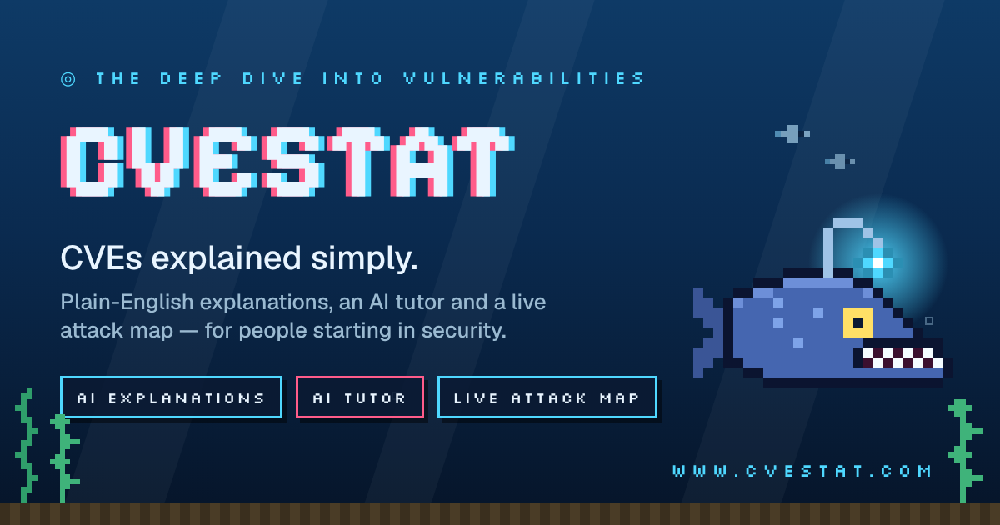
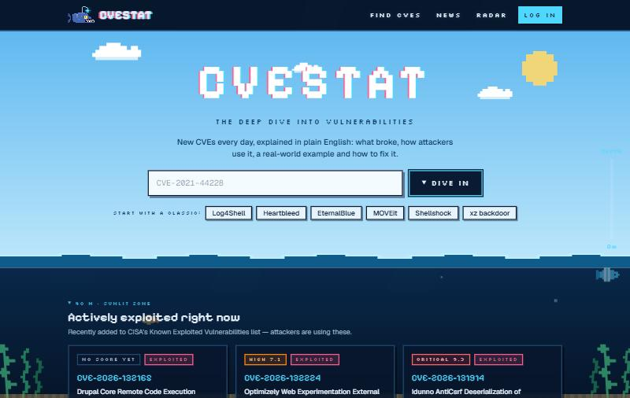
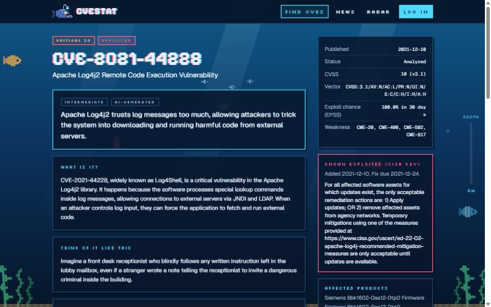
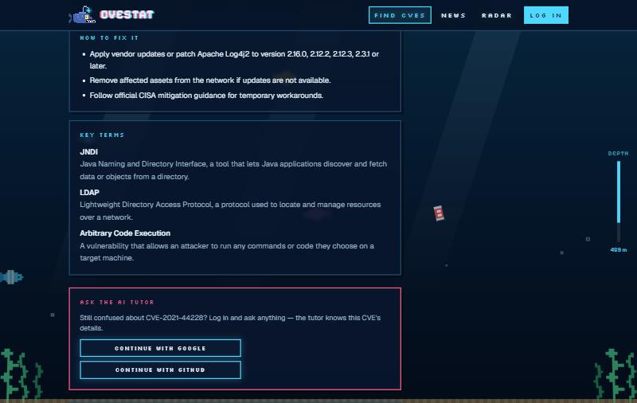
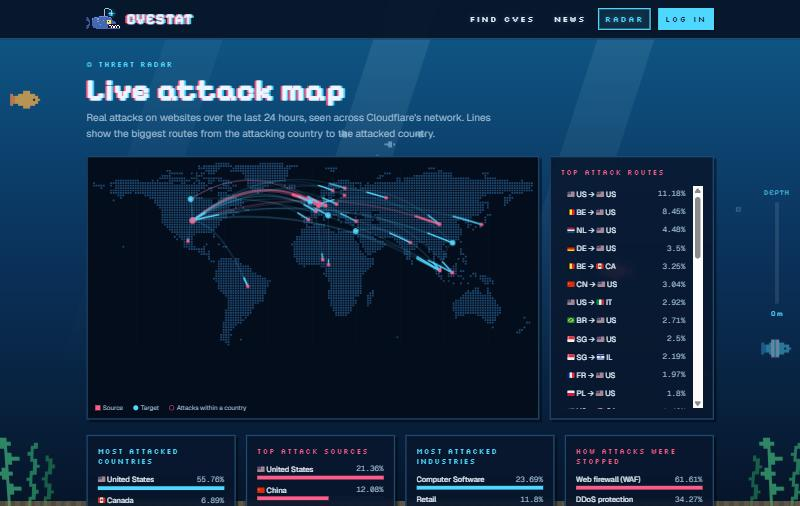
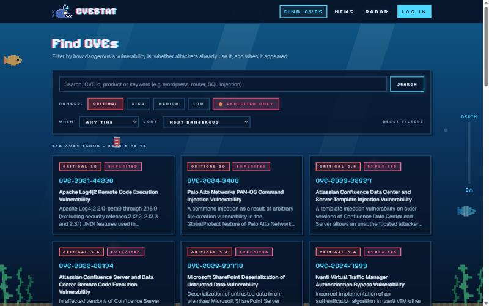
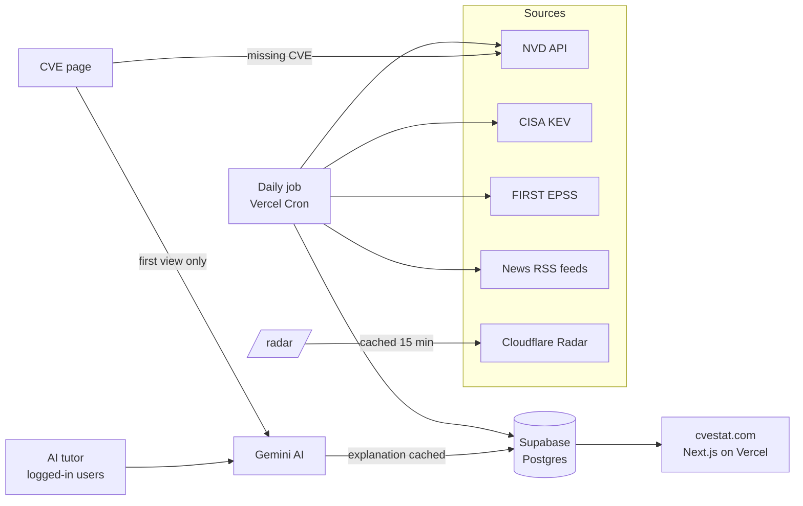

<p align="center">
  
</p>

# CVEStat

**CVEs explained simply.** A learning site for students and junior security specialists: every CVE gets a plain-English explanation, a real-world example and an AI tutor, plus security news and a live map of cyberattacks.

🌊 **Live:** [www.cvestat.com](https://www.cvestat.com)

Official CVE descriptions are written for experts — one dense sentence full of jargon. CVEStat turns them into something a beginner can actually learn from.

## Features

- **Any CVE, explained** — open any CVE ever published (`/cve/CVE-2021-44228`). You get a TL;DR, an everyday analogy, how the attack works (concepts only, no exploit code), a realistic example, impact, how to fix it and key terms.
- **AI tutor per CVE** — log in with Google or GitHub and ask follow-up questions. The tutor knows that CVE's data and the explanation on the page.
- **Find CVEs** — filter by danger level, "actively exploited", time period and keyword; sort by newest, most dangerous or most likely to be exploited. Filters live in the URL, so every view is shareable.
- **Threat Radar** — a live pixel-art map of real attack routes over the last 24 hours, plus the most attacked countries, industries and attack types.
- **Security news** — headlines from trusted sources with our own short AI summary and the CVEs they mention.
- **"Deep dive" design** — an original pixel-art ocean: the deeper you scroll, the darker the water.

## Screenshots

| Homepage | CVE page |
|---|---|
|  |  |
| **Explanation + AI tutor** | **Threat Radar** |
|  |  |
| **Find CVEs** | |
|  | |

## How it works



- **Daily job** (Vercel Cron): new CVEs from NVD, CISA's Known Exploited Vulnerabilities, EPSS exploit probabilities and news → Supabase. Self-healing: anything that failed is retried next run.
- **Explanations are generated once**, the first time a person opens a CVE, then saved for everyone — so AI cost stays at zero.
- **Ranking**: a database-generated "importance" score (exploited in the wild, exploit probability, severity).

## Tech stack

Next.js 16 (App Router, Cache Components) · React 19 · TypeScript · Tailwind CSS 4 · Supabase (Postgres, Auth) · Google Gemini · Vercel · d3-geo (map generation) · Zod

## Security & privacy decisions

Built by a security learner, so the site tries to practise what it teaches:

- **Least privilege database** — Row Level Security on every table; the browser can only read public data. All writes go through the server with a secret key that can never reach the browser (`server-only`).
- **Abuse limits** — atomic daily quotas in Postgres: AI explanations per visitor and per day, chat questions per user, a cap on on-demand NVD lookups.
- **Safe AI** — the tutor never writes exploit code, stays on topic, ignores prompt-injection attempts and never asks for personal data. AI output is rendered as text, never HTML.
- **Input validation** — every URL/API input is validated (Zod, allow-lists); search text is sanitised before it reaches a database query; only `http(s)` links are rendered.
- **Hardening** — HSTS, clickjacking protection, `nosniff`, a cron endpoint that fails closed, an open-redirect check on login.
- **Privacy by design** — chats are never stored on the server, usage counters are deleted after 7 days, analytics are cookie-less. The AI tutor is disabled in the EU/UK/Switzerland because the free Gemini tier may not be offered there.

## Running costs

$0 per month (only the domain renewal): Vercel Hobby, Supabase Free, Gemini free tier and free public data sources. This is a non-commercial portfolio project.

## Data sources & credits

- CVE data: [NVD](https://nvd.nist.gov/) — *this product uses data from the NVD API but is not endorsed or certified by the NVD.*
- Exploited vulnerabilities: [CISA KEV](https://www.cisa.gov/known-exploited-vulnerabilities-catalog) · exploit probability: [FIRST EPSS](https://www.first.org/epss/)
- Attack data: [Cloudflare Radar](https://radar.cloudflare.com/) (CC BY-NC 4.0)
- Map: [Natural Earth](https://www.naturalearthdata.com/) (public domain) · flags: [Twemoji](https://github.com/twitter/twemoji) (CC BY 4.0)
- All pixel art is original.

## Run it locally

```bash
npm install
cp .env.example .env.local      # fill in your keys
# run supabase/migrations/*.sql in the Supabase SQL editor
npm run dev
```

## Project layout

```
src/app/              pages and API routes
  page.tsx            homepage
  cve/[id]/           CVE page (explanation + AI tutor)
  cves/  news/  radar/  privacy/
  api/explain/        generates and saves explanations
  api/chat/           AI tutor
  api/cron/daily/     daily data update
  auth/callback/      login
src/components/       UI (ocean/ = pixel art, radar/ = attack map)
src/lib/              data sources, database, AI, limits
scripts/              build-time generators (world map)
supabase/migrations/  SQL schema
docs/                 learning log + screenshots
```

## Author

Built by **Nikoloz Lomtadze**, Computer Science student at Business and Technology University (BTU), Tbilisi.
